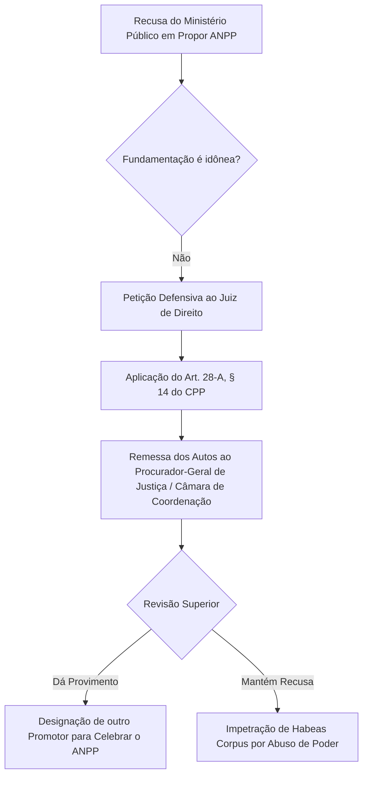

# Guia Estratégico: Acordo de Não Persecução Penal (ANPP)

**Autor:** Juan Diego Angélico (Angélico Anziutti Advocacia)  
**Marco Normativo:** Art. 28-A do Código de Processo Penal (Lei nº 13.964/2019)  
**Precedentes dos Tribunais Superiores:** STF - HC nº 185.913/DF e HC nº 221.732/SP; STJ - Tema Repetitivo 1.098

---

## 1. O que é o ANPP e seus Requisitos Legais

O Acordo de Não Persecução Penal é um negócio jurídico processual celebrado entre o Ministério Público e o investigado, com homologação judicial, que extingue a punibilidade sem gerar reincidência nem antecedentes criminais.

### Requisitos Cumulativos Obrigatórios (Art. 28-A, caput):
1. **Confissão Formal e Circunstanciada:** Apenas para os fins do acordo (não pode ser usada como prova condenatória caso o acordo seja rescindido ou não homologado).
2. **Infração Penal Sem Violência ou Grave Ameaça à Pessoa.**
3. **Pena Mínima Inferior a 4 Anos:** Consideradas as causas de aumento e diminuição aplicáveis ao caso concreto.
4. **Necessidade e Suficiência para Reprovação e Prevenção do Crime.**

---

## 2. Momento Processual para Propositura

* **Regra Geral:** Na fase de inquérito policial ou investigação preliminar, antes do oferecimento da denúncia.
* **Aplicação Retroativa (STF e STJ):** O ANPP aplica-se aos processos em andamento iniciados antes da vigência do Pacote Anticrime, desde que ainda não transitada em julgado a condenação, devendo o juízo oportunizar manifestação ministerial.

---

## 3. Estratégia Diante da Recusa Imotivada do Ministério Público

Se o Ministério Público recusar-se a propor o ANPP com fundamentação genérica (ex.: *"não é suficiente para reprovação do crime"* em delito sem violência e réu primário):

O ANPP constitui um **direito subjetivo do investigado** quando preenchidos todos os requisitos objetivos e subjetivos legais, não podendo ser negado por mero capricho acusatório.
