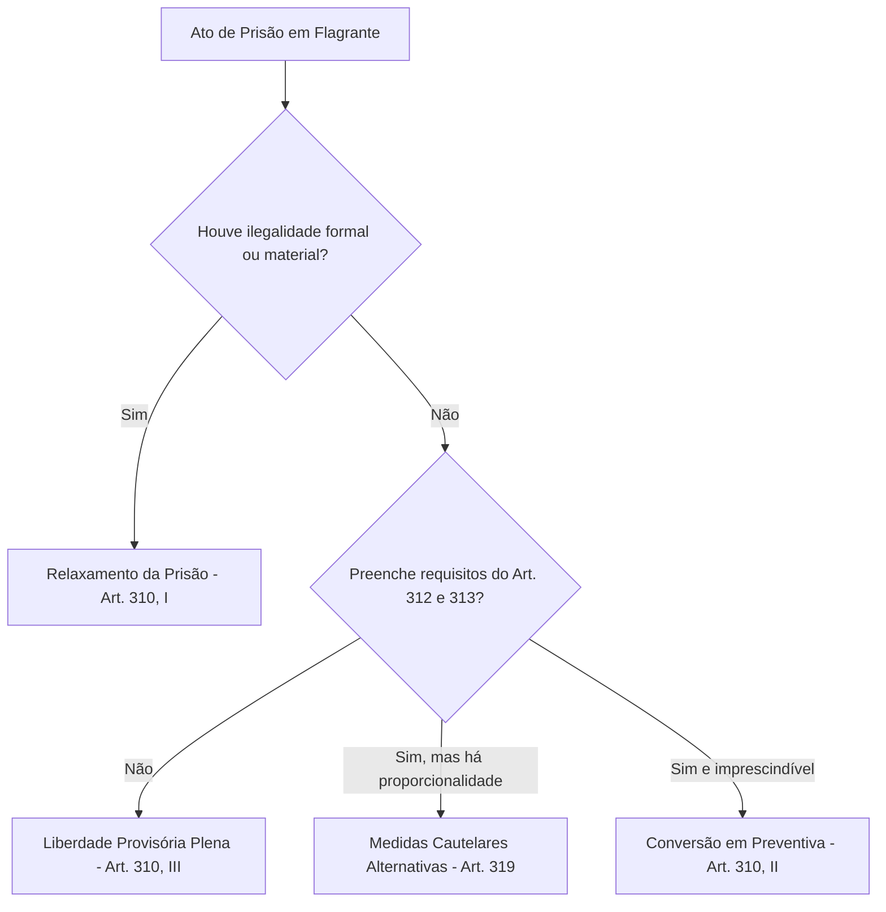

# Guia Estratégico: Atuação Combativa na Audiência de Custódia

**Autor:** Juan Diego Angélico (Angélico Anziutti Advocacia)  
**Base Normativa:** Art. 310 do CPP, Resolução nº 213 do CNJ, Pacto de San José da Costa Rica

---

## 1. Finalidade Estrita do Ato

A audiência de custódia não serve para julgar o mérito da acusação nem para produzir prova exauriente sobre autoria delitiva. Seus três objetivos exclusivos são:
1. **Fiscalizar a legalidade da prisão em flagrante** (art. 5º, LXV, CF/88 c/c art. 310, I, CPP).
2. **Aferir a integridade física e psíquica do custodiado**, prevenindo e apurando atos de tortura ou maus-tratos.
3. **Decidir sobre a necessidade cautelar da custódia** (relaxamento, conversão em preventiva ou liberdade provisória com medidas cautelares alternativas - art. 319 do CPP).

---

## 2. A Entrevista Prévia e Reservada (Protocolo de 5 Minutos)

O advogado tem direito intransigível de conversar com o cliente antes do início da sessão (art. 7º, III da Lei nº 8.906/94):

1. **Acolhimento e calma:** Informar que você está ali pela família e que a audiência não é o julgamento final.
2. **Identificação de violência policial:** Perguntar diretamente se houve agressão, tapas, sufocamento ou ameaças durante a abordagem ou no trajeto da viatura. Se houver lesões, instruir o cliente a relatar perante o magistrado.
3. **Direito ao Silêncio sobre os Fatos:** Relembrar que qualquer pergunta do juiz ou do Ministério Público sobre o fato em si não precisa ser respondida. O foco do cliente deve ser responder apenas sobre condições pessoais (residência, família, ocupação lícita).

---

## 3. Matriz de Pedidos Orais (Art. 310 do CPP)

### Pedidos Subsidiários Obrigatórios:
1. **Preliminar de Relaxamento:** Ausência de nota de culpa no prazo de 24h, violação de domicílio sem mandado e sem fundadas razões prévias (Tema 280/STF), ou busca pessoal exploratória sem justa causa (RHC 158.580/BA).
2. **Liberdade Provisória com Medidas Cautelares (art. 319, CPP):**
   * Comparecimento periódico em juízo.
   * Proibição de ausentar-se da comarca.
   * Recolhimento domiciliar noturno.
   * Monitoração eletrônica (se estritamente indispensável).
3. **Dispensa de Fiança:** Demonstrar hipossuficiência econômica do custodiado (art. 325, § 1º, I c/c art. 350 do CPP).
