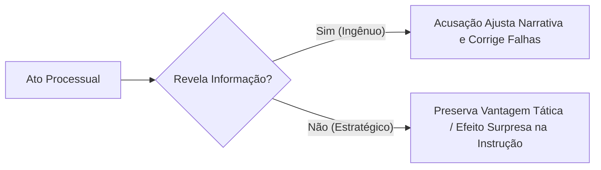

# Guia Estratégico: Teoria dos Jogos Aplicada ao Processo Penal Acusatório

**Autor:** Juan Diego Angélico (Angélico Anziutti Advocacia)  
**Marco Teórico:** Análise Econômica do Direito, Teoria dos Jogos no Processo Penal (Alexandre Morais da Rosa), Garantismo e Sistema Acusatório

---

## 1. A Ilusão da "Verdade Real" e a Realidade do Jogo Processual

O processo penal não é uma marcha asséptica e colaborativa em direção a uma verdade histórica abstrata. Ele opera, faticamente, como um jogo estratégico interativo de informação assimétrica, onde os jogadores (Acusação, Defesa, Magistrado, Polícia) agem movidos por incentivos institucionais, custos e expectativas de resultado (*payoff*).

---

## 2. As Regras do Jogo para a Defesa Penal

### 2.1 A Gestão do Segredo e o Teorema do Minimax
Na teoria dos jogos de von Neumann e Morgenstern, a estratégia *minimax* busca minimizar a perda máxima possível diante do pior cenário antecipado.

No processo penal:
* **Na Resposta à Acusação (art. 396-A, CPP):** Não revele argumentos de mérito que dependam de contradição testemunhal. A revelação precoce permite que a acusação prepare suas testemunhas e oriente os policiais condutores antes da audiência.
* **No Interrogatório Policial:** O silêncio tático resguarda o cliente enquanto a defesa não tem acesso integral à cadeia de custódia da prova (art. 158-A do CPP e Súmula Vinculante 14).

### 2.2 Mapeamento da Matriz de Payoffs dos Atores
1. **Ministério Público:** Incentivado pela confirmação da hipótese acusatória e condenações exemplares. Sofre custo reduzido ao pedir diligências de ofício.
2. **Magistrado:** Incentivado pela celeridade (metas do CNJ) e por manter sentenças íntegras nos Tribunais (evitando reformas vexatórias).
3. **Defesa:** Busca primariamente a liberdade do cliente, a nulidade da prova ilícita e o esvaziamento do standard probatório condenatório (*beyond a reasonable doubt*).
